# Ironward

**Sparatutto in prima persona multiplayer nel browser, in stile VGA anni '90, con mappe procedurali.**

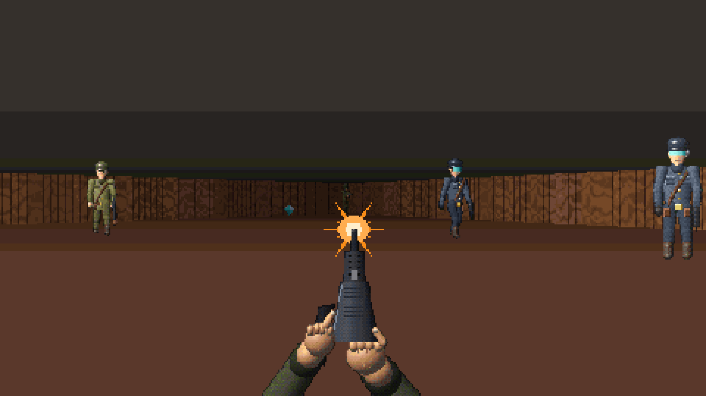


Ironward riprende le meccaniche degli FPS a griglia dei primi anni '90 (raycasting, porte
scorrevoli, pareti segrete, sprite orientati) e le porta in rete: cooperativa contro l'IA,
deathmatch, squadre, cattura dei documenti, account con livelli, clan e classifiche.

Si gioca aprendo una pagina web: niente installazione. Personaggi, nemici, oggetti e armi sono
pixel art **originale disegnata con [PixelLab](https://www.pixellab.ai)**; pareti, palette, suoni e
livelli sono **generati dal codice**. Nessun asset di altri giochi.

---

## Indice

- [In breve](#in-breve)
- [Immagini](#immagini)
- [Avvio rapido](#avvio-rapido)
- [Comandi](#comandi)
- [Modalità di gioco](#modalità-di-gioco)
- [Armi e nemici](#armi-e-nemici)
- [Account, EXP e sblocchi](#account-exp-e-sblocchi)
- [Clan](#clan)
- [Amministrazione](#amministrazione)
- [Grafica](#grafica)
- [Mappe procedurali](#mappe-procedurali)
- [Architettura](#architettura)
- [Rete](#rete)
- [Sviluppo e test](#sviluppo-e-test)
- [API](#api)
- [Configurazione](#configurazione)
- [Deploy su Debian](#deploy-su-debian)
- [Prossimi passi](#prossimi-passi)
- [Licenza](#licenza)

## In breve

| | |
|---|---|
| **Modalità** | Cooperativa (fino a 8 contro l'IA), Deathmatch, Deathmatch a squadre, Cattura i documenti |
| **Mappe** | 64×64 celle generate da un seed condivisibile; simmetriche nelle modalità a squadre |
| **Progressione** | Account, EXP, 50 livelli, colori e copricapi sbloccabili, bonus in cooperativa |
| **Social** | Clan con sigla e codice d'invito, sfide tra clan, classifiche settimanali e di sempre |
| **Grafica** | Sprite e pareti PixelLab, luce a 32 scalini, figure a 8 viste |
| **Audio** | Musica chiptune composta dal seed di ogni livello, effetti sintetizzati con riverbero |
| **Tecnica** | TypeScript su Node 26 (senza compilazione lato server), Canvas 2D, WebSocket, SQLite |
| **Gestione** | Pannello di amministrazione: espulsioni, sospensioni, correzioni, registro |

## Immagini

| Cattura i documenti | Deathmatch |
|---|---|
| 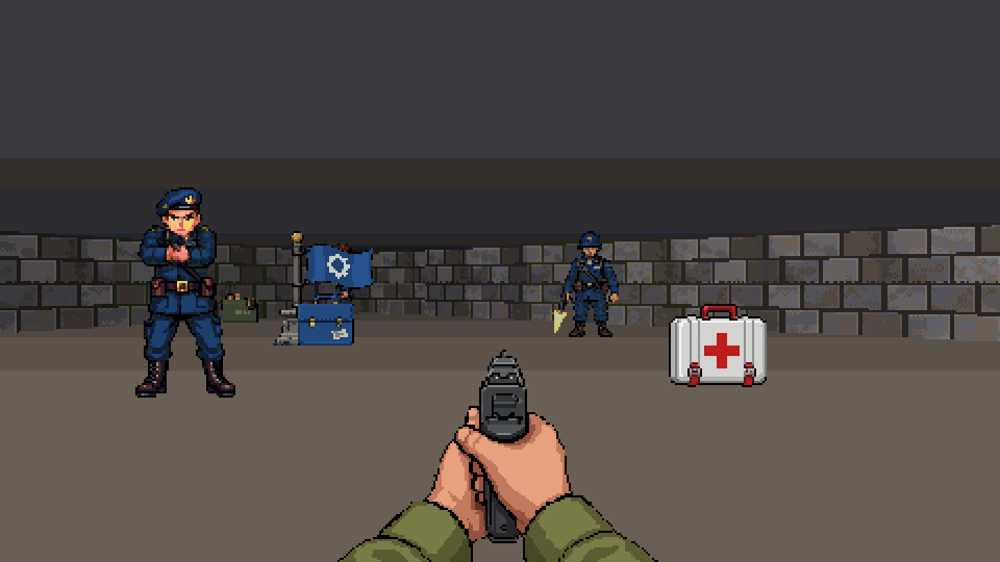 | 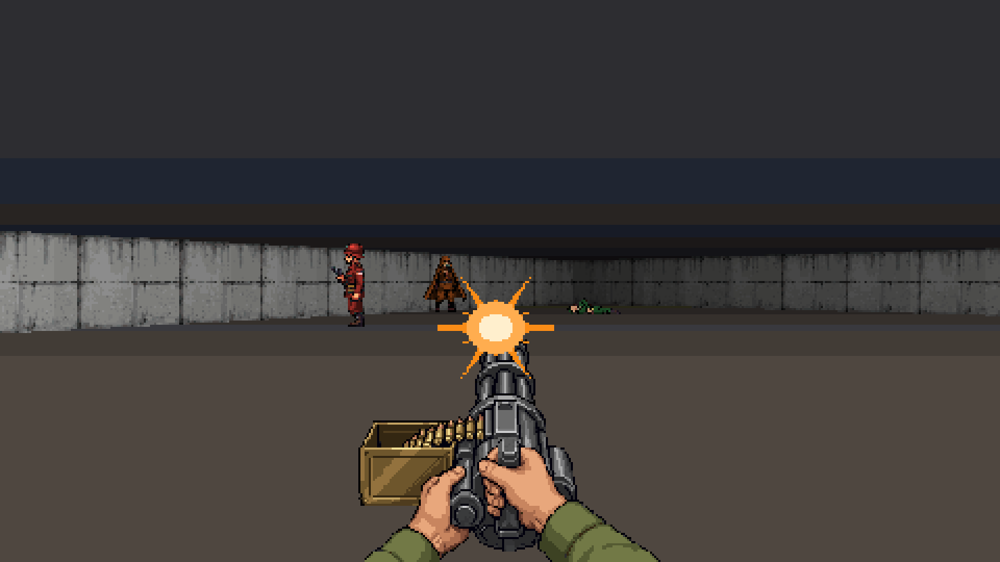 |

Le immagini di gioco qui sopra sono renderizzate dal motore stesso (`npm run screenshots`),
senza l'HUD. Quelle dell'interfaccia vengono dal browser.

| Menu e profilo | Scheda del clan | Classifica |
|---|---|---|
| 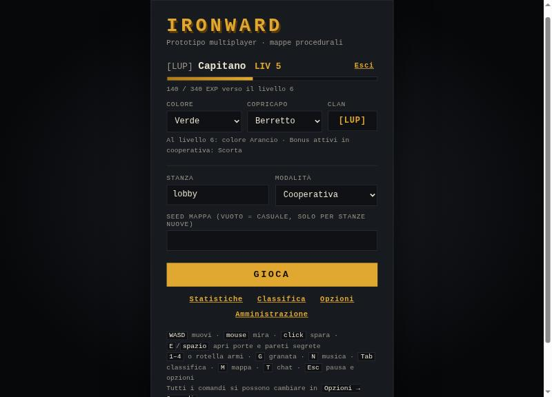 | 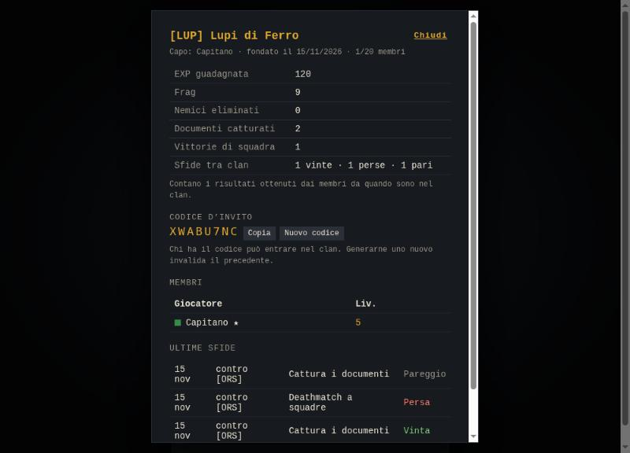 | 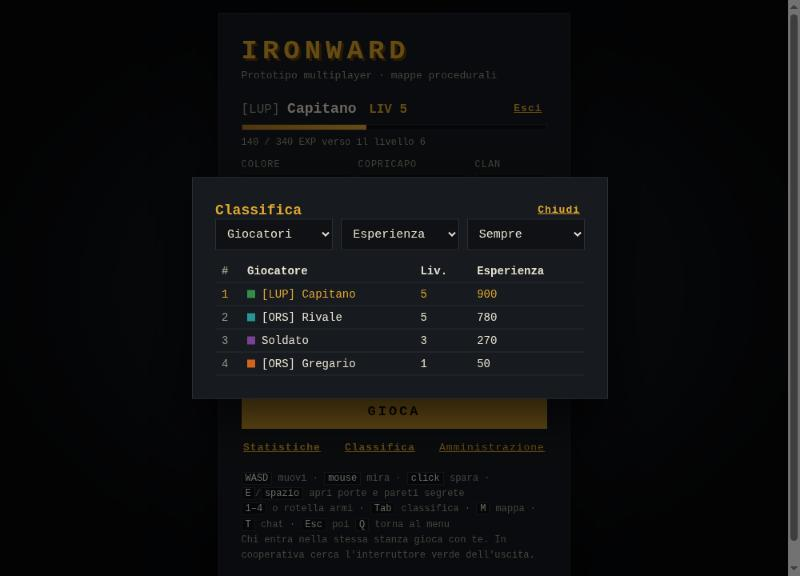 |

## Avvio rapido

Serve **Node.js ≥ 23.6**, che esegue direttamente i file `.ts` (sviluppato su Node 26).

```bash
npm install
npm run build      # compila il client in client/dist/
npm start          # server su http://localhost:8080
```

Apri `http://localhost:8080`, accedi o gioca da ospite, scegli stanza e modalità. Chi entra
nella stessa stanza gioca con te; il link `?room=nome&mode=ctf` porta direttamente in una stanza.

## Comandi

| Tasto | Azione |
|---|---|
| WASD / frecce | movimento (← → ruotano) |
| mouse, click / Ctrl | mira e fuoco |
| E / spazio | apri porte, pareti segrete, interruttore d'uscita |
| 1–4, rotella | coltello, pistola, mitraglietta, mitragliatrice |
| G | lancia una granata |
| N | musica sì/no (la scelta viene ricordata) |
| Tab | classifica della partita |
| M | minimappa |
| T / Invio | chat |
| Esc, poi Q | torna al menu |

## Modalità di gioco

**Cooperativa.** Fino a 8 giocatori contro sentinelle, assaltatori, mastini e il Comandante.
Bisogna trovare l'interruttore verde dell'uscita; il livello successivo nasce da un seed derivato e
armi, munizioni, armatura e granate si conservano. Nella maggior parte dei livelli la stanza
dell'uscita è chiusa da **porte blindate**: la **tessera** che le apre sta in una stanza a metà
percorso, sorvegliata dal Comandante, e basta che un giocatore la raccolga per tutta la squadra.
Si guadagna di più ripulendo il livello e scoprendo i passaggi segreti.

**Deathmatch.** Niente nemici, più anelli nella mappa, oggetti che ricompaiono dopo 20 secondi.
Vince chi arriva a 15 frag, poi parte una nuova mappa.

**Deathmatch a squadre.** Ferro (rosso) contro Cobalto (blu): ogni frag vale un punto alla
squadra, vince chi arriva a 30. Niente fuoco amico: i compagni non vengono colpiti e non
bloccano i proiettili.

**Cattura i documenti.** Ogni squadra ha una base con stendardo e una valigetta di documenti.
Si prendono i documenti avversari e si portano alla propria base, purché i propri siano al loro
posto. Se il portatore muore la valigetta resta a terra: la squadra che l'ha persa la recupera
toccandola, altrimenti torna da sola dopo 20 secondi. Vince chi fa 3 catture.

Regole comuni alle squadre:
- partite di massimo 10 minuti; allo scadere vince chi ha più punti, altrimenti è pareggio;
- mappe a **simmetria centrale**: la metà destra è la sinistra ruotata di 180°, con porte, segreti,
  armi e oggetti negli stessi punti per entrambe le squadre;
- chi entra a partita in corso va nella squadra meno numerosa; a ogni nuova partita le squadre si
  ricompongono tenendo insieme i membri di uno stesso clan, con al massimo un giocatore di differenza;
- la minimappa mostra solo i compagni (in deathmatch nessuno, in cooperativa tutti).

## Armi e nemici

| Arma | Danno | Cadenza | Note |
|---|---|---|---|
| Coltello | 14–26 | 0,45 s | corpo a corpo, nessuna munizione |
| Pistola | 12–24 | 0,36 s | precisa |
| Mitraglietta | 9–18 | 0,12 s | dispersione media |
| Mitragliatrice | 9–18 | 0,07 s | dispersione alta, consuma molto |

| Nemico | Salute | Velocità | Attacco | EXP |
|---|---|---|---|---|
| Sentinella | 25 | lenta | fucile, 4–12 | 10 |
| Assaltatore | 60 | media | raffiche rapide, 3–9 | 25 |
| Mastino | 18 | molto veloce | morso, 5–12 | 15 |
| Comandante | 140 | media | revolver pesante, 8–18 | 60 |

| Oggetto | Effetto |
|---|---|
| Giubbotto antiproiettile | +50 armatura (massimo 100): l'armatura assorbe metà dei danni |
| Granate | +2 (massimo 5). Con G si lanciano: rimbalzano sui muri ed esplodono dopo 1,6 s, con raggio 2,8 celle e danno fino a 95. Il lanciatore subisce metà danno; compagni e giocatori in cooperativa sono illesi |
| Tessera | apre le porte blindate della stanza d'uscita (cooperativa) |

L'IA ha stati di guardia, allarme (si propaga con il rumore degli spari), inseguimento sul
campo di distanze BFS, mira con tempo di reazione, dolore e morte.

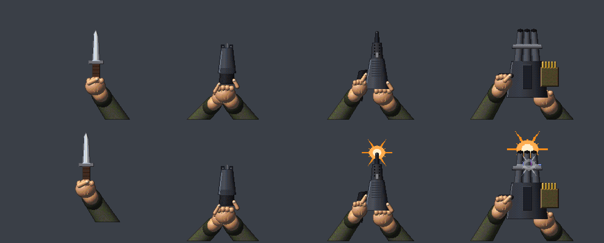

## Account, EXP e sblocchi

- **Accesso**: nome e password (hash scrypt), sessione di 30 giorni. Si può giocare **da ospite**,
  ma EXP e statistiche non vengono salvate. Un account è connesso da una sola finestra alla volta.
- **Livelli** da 1 a 50: per salire dal livello *l* servono 100 + 60·(*l*−1) EXP.

| Fonte di EXP | | Fonte di EXP | |
|---|---|---|---|
| Sentinella / mastino / assaltatore | 10 / 15 / 25 | Frag | 50 |
| Serie di 3 / 5 / 10 eliminazioni | +25 / +50 / +100 | Vittoria in deathmatch | 150 |
| Passaggio segreto | 20 | Documenti presi o recuperati | 20 |
| Monete / gemma | 2 / 10 | Cattura | 100 |
| Uscita / livello ripulito | 100 / +60 | Portatore avversario eliminato | +25 |
| | | Vittoria di squadra | 100 |

- **Sblocchi**: colori ai livelli 2, 4, 6, 9; copricapi (berretto, basco 3, elmetto 5, cappuccio 8,
  fascia 12); fondazione di un clan al livello 3.
- **Bonus solo in cooperativa** (nelle modalità competitive tutti partono alla pari): Scorta
  (liv. 4, +8 munizioni iniziali), Tempra (liv. 7, +15 salute massima), Raccoglitore (liv. 10, +50%
  munizioni raccolte), Veterano (liv. 15, altri +15 salute).
- **Statistiche persistenti**: nemici, frag, morti, precisione, danni, livelli completati, vittorie,
  catture, segreti, tesori, serie e punteggio migliori, tempo di gioco. Si salvano ogni 60 secondi, a
  fine partita, all'uscita e allo spegnimento del server.
- **Classifiche** per EXP, frag, nemici e catture, di sempre o degli ultimi 7 giorni.

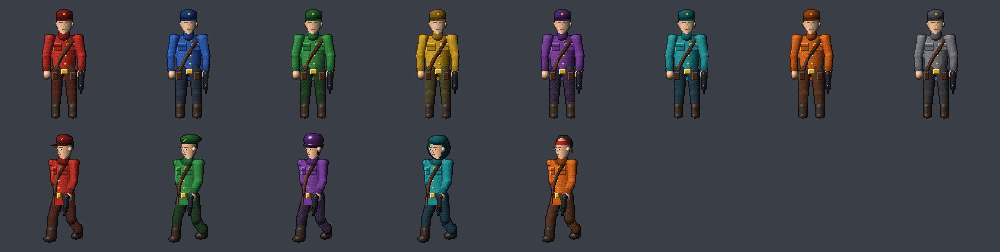

## Clan

- Dal livello 3 si **fonda** un clan con sigla (2–4 caratteri) e nome; si entra con il **codice
  d'invito**, visibile solo ai membri. Massimo 20 membri, un clan per giocatore.
- La sigla compare davanti al nome, sopra la testa in partita e nelle classifiche.
- Il **capo** genera nuovi codici, allontana i membri e cede il comando. Se esce, comanda il membro
  con più EXP; l'ultimo che esce scioglie il clan.
- **Statistiche del clan**: EXP, frag, nemici, catture e vittorie ottenute *da quando si è membri*.
- **Sfide tra clan**: se a fine partita a squadre ogni squadra è formata da membri di un solo clan
  (almeno due registrati per parte), l'esito finisce nello storico come vittoria, sconfitta o pareggio.
- **Classifica dei clan** per EXP, frag, catture e sfide vinte.

## Amministrazione

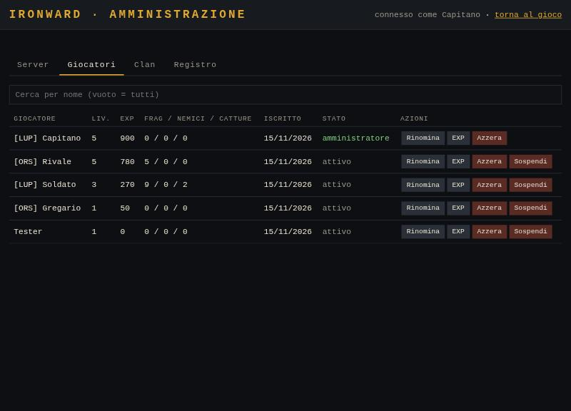

Non esistono credenziali predefinite: il ruolo si assegna dal server con `tools/admin.ts`, che
usa lo stesso `DB_PATH` del server e funziona anche a server acceso.

```bash
node tools/admin.ts create <nome>     # nuovo account admin; la password si legge da stdin
node tools/admin.ts promote <nome>    # rende admin un account esistente
node tools/admin.ts demote <nome>     # toglie il ruolo
node tools/admin.ts list              # elenca gli amministratori
node tools/admin.ts unban <nome>      # riattiva un account sospeso
```

Gli amministratori vedono nel menu il collegamento **Amministrazione** (`/admin.html`):

| Scheda | Cosa si può fare |
|---|---|
| **Server** | giocatori in partita, stanze attive con modalità, livello, timer e giocatori; messaggio a tutte le stanze o a una; espulsione; chiusura di una stanza |
| **Giocatori** | ricerca; cambio nome; correzione dell'EXP; azzeramento di EXP e statistiche (anche nelle classifiche settimanali); sospensione con motivo e riattivazione |
| **Clan** | ricerca; cambio di sigla e nome; scioglimento |
| **Registro** | ogni azione, anche da riga di comando, con data, autore, bersaglio e dettagli |

Un account sospeso viene disconnesso, perde tutte le sessioni e al login vede il motivo. Gli
amministratori non si possono sospendere finché hanno il ruolo. Le modifiche a chi è in partita
valgono subito: nome e sigla cambiano sopra la testa e le statistiche in sospeso vengono salvate
prima di essere corrette.

## Grafica

Stile VGA/SVGA anni '90.

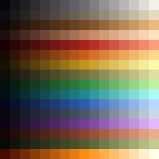

- **Sprite PixelLab**: sentinella, assaltatore, mastino, Comandante, 5 modelli di giocatore (uno per
  copricapo), oggetti, esplosioni, stendardi, valigette, armi in prima persona e le 16 texture delle
  pareti (porte e porta blindata comprese) sono pixel art generata con PixelLab; le figure sono a
  **8 direzioni** con animazioni di passo, mira e fuoco, dolore e caduta. I file sorgente sono in
  `assets/pixellab/`; `npm run sprites` li impacchetta in un atlante (`client/sprites/`).
- **Colori di squadra**: le divise dei giocatori, gli stendardi e le valigette sono disegnati in un
  verde "chiave" che il client sostituisce con il colore del giocatore o della squadra, mantenendo
  le ombre. Cinque modelli bastano così per 8 colori × 5 copricapi.
- **Palette di 256 colori** in 16 rampe da 16 tonalità per pavimenti, soffitti e la grafica
  procedurale di ripiego, ridotte con un dithering ordinato 4×4.
- **Luce a 32 scalini**: la distanza scurisce pareti e sprite a gradini, pavimento e soffitto
  mostrano le bande tipiche dell'epoca e la vampa dell'arma illumina la scena. Gli sprite PixelLab
  restano a colori pieni e ricevono la stessa luce, così non perdono sfumature.
- **Il client sceglie la vista** dall'angolo tra la direzione della figura e la telecamera.
- **Ripiego procedurale**: se l'atlante manca, il gioco disegna da sé figure (scheletri 3D proiettati
  in 8 viste), oggetti e armi.

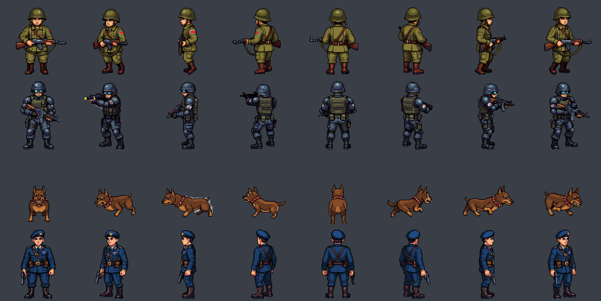

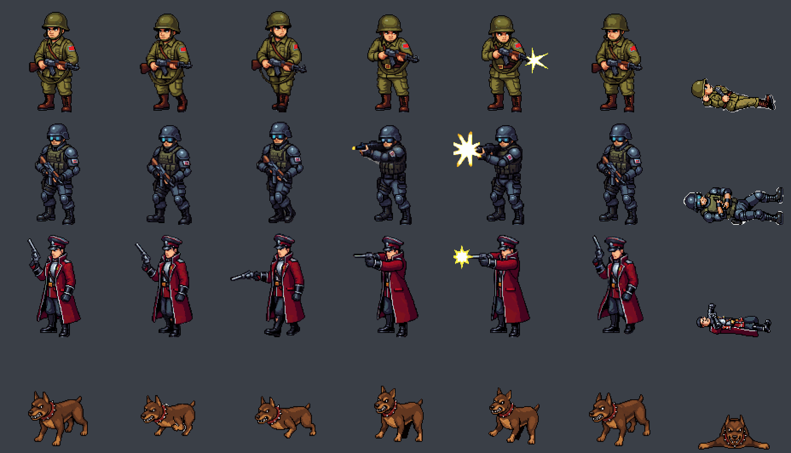

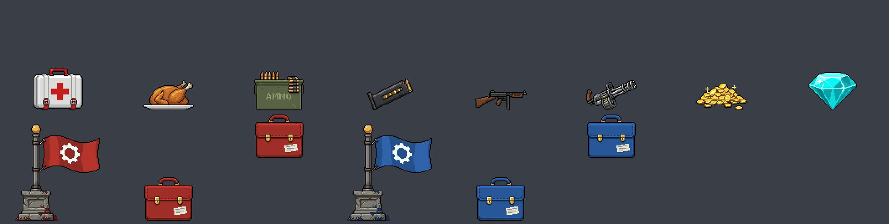

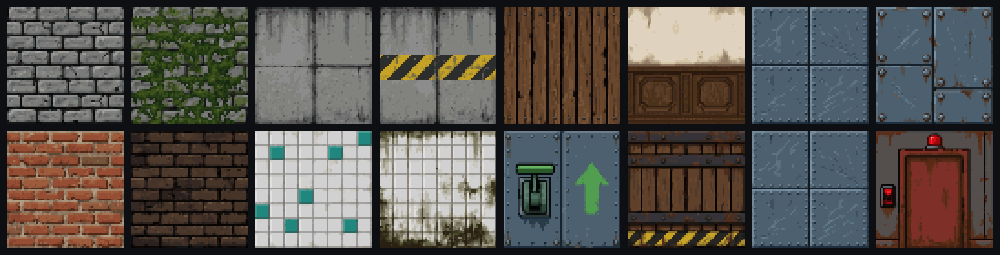

## Audio

Tutto il suono è generato in tempo reale con WebAudio, senza file audio.

- **Musica procedurale**: ogni livello compone il proprio brano chiptune dal seed della mappa
  (tonalità, giro di accordi, basso, melodia con variazioni, arpeggio e batteria su 8 battute in
  loop). Il tema decide il carattere: marcia in minore per la Fortezza, frigio cupo e incalzante per
  il Bunker, minore armonico lento per l'Archivio, dorico sintetico per il Laboratorio. Durante gli
  scontri (spari vicini, allarmi, ferite) batteria, arpeggio e melodia si fanno più presenti, poi
  in qualche secondo la musica torna calma. Il tasto **N** la spegne o la riaccende.
- **Effetti**: spari con schiocco, corpo e coda, esplosioni, porte, passi, nemici, raccolte e
  segnali delle squadre, tutti sintetizzati. Spari, porte ed esplosioni passano anche da un
  **riverbero** generato al volo, che dà il suono dei corridoi di pietra.

## Mappe procedurali

Ogni livello è una griglia 64×64 generata da un seed con un PRNG deterministico (mulberry32):

1. **BSP**: lo spazio viene diviso ricorsivamente, con una stanza in ogni foglia;
2. **corridoi a L** tra stanze sorelle, così il grafo è sempre connesso, più anelli extra
   (molti di più nelle modalità competitive);
3. **porte** dove un corridoio attraversa la cornice di una stanza, con stipiti;
4. **pareti segrete** che si aprono scorrendo su ripostigli con un premio;
5. **uscita** nella stanza più lontana a piedi dall'inizio (cooperativa);
6. **popolamento**: nemici più duri man mano che ci si allontana dall'inizio, armi, munizioni,
   cure e tesori.

Nelle modalità a squadre si genera solo la metà sinistra e ogni modifica viene ripetuta nella
cella ruotata di 180°; alcuni corridoi attraversano il centro collegando le due metà. Il test del
generatore controlla 1200 mappe: bordi chiusi, nessuna cella irraggiungibile, porte con stipiti,
oggetti su celle libere, simmetria perfetta e basi collegate senza passare dai segreti.

## Architettura

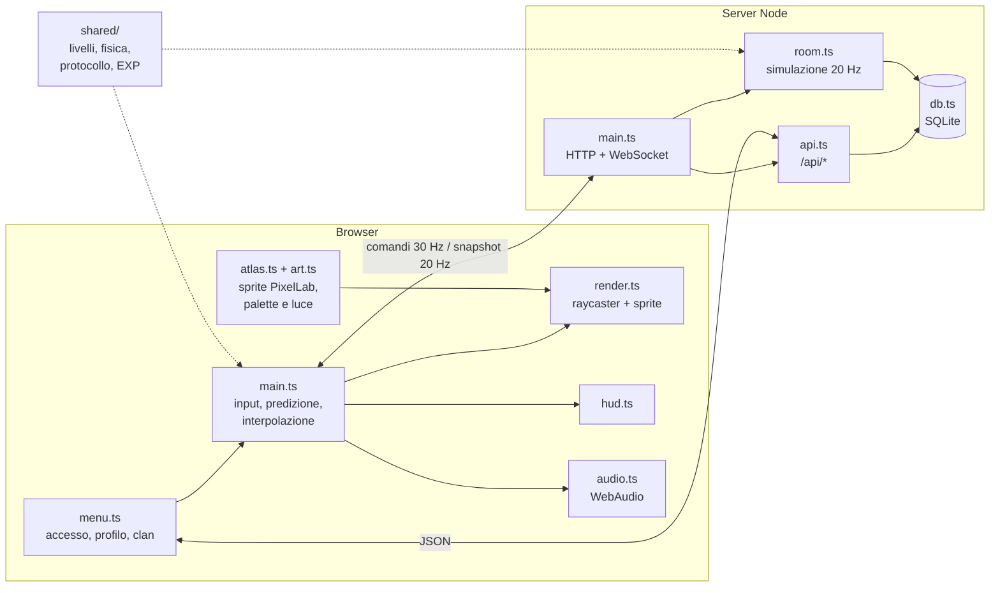

```
shared/   codice usato da client e server
  rng.ts          PRNG deterministico (mulberry32) e hash dei seed
  level.ts        generatore di livelli (BSP, corridoi, porte, segreti, simmetria)
  physics.ts      collisioni, movimento, raycast DDA con porte scorrevoli, linea di vista, BFS
  defs.ts         armi, nemici, oggetti, modalità, squadre
  protocol.ts     messaggi JSON tra client e server
  progression.ts  curva EXP, ricompense, sblocchi, bonus, clan
server/
  main.ts         HTTP statico, API, WebSocket (/ws), ciclo a passo fisso
  room.ts         stato autoritativo di una stanza: input, armi, IA, porte, oggetti, squadre, EXP
  db.ts           SQLite: utenti, sessioni, statistiche, clan, amministrazione (schema v4 con migrazioni)
  api.ts          rotte /api/*
client/
  main.ts         ciclo di gioco, input, predizione e riconciliazione, eventi
  menu.ts         accesso, profilo, statistiche, classifiche, clan
  render.ts       raycaster software su ImageData a 270 righe, z-buffer, sprite, colormap
  palette.ts      palette a 256 colori, dithering, colormap, pennello ombreggiato
  art.ts          texture, sprite (scheletri 3D, 8 viste), armi in prima persona
  audio.ts        effetti sintetizzati con WebAudio
  hud.ts          HUD, minimappa, classifica della partita
  admin.ts        pannello di amministrazione
tools/            test, generatore delle immagini, gestione degli amministratori
deploy/           unità systemd e configurazione nginx
```

## Rete

- **Server autoritativo**: il client manda solo comandi (avanti, laterale, angolo, pulsanti) a
  30 Hz; posizione, colpi, danni, porte e oggetti li decide il server, che simula a 20 Hz.
- **Mappa via seed**: in rete viaggia solo il seed, e ogni client rigenera lo stesso livello.
- **Predizione e riconciliazione**: il client applica subito i propri input con la stessa
  `applyPlayerInput` del server, poi li riapplica sopra ogni snapshot confermato e smorza l'errore residuo.
- **Interpolazione**: gli altri giocatori e i nemici sono mostrati 110 ms nel passato,
  interpolando posizioni e angoli tra due snapshot.
- **Compensazione della latenza**: ogni sparo porta con sé il tick del server che il client stava
  mostrando; il server conserva un secondo di posizioni e controlla il colpo contro giocatori e
  nemici *dove il tiratore li vedeva* (fino a 400 ms indietro), mentre muri e porte restano quelli
  attuali. Chi ha un ping alto colpisce ciò che ha sullo schermo.
- **Sicurezza**: limite di comandi per connessione, nomi e messaggi ripuliti, una sessione per
  account, tentativi di accesso limitati per IP, token salvati solo come hash.

## Sviluppo e test

| Comando | Cosa fa |
|---|---|
| `npm run build` | compila il client con esbuild in `client/dist/` |
| `npm start` | avvia il server |
| `npm run check` | type-check con `tsc` (strict, solo sintassi cancellabile) |
| `npm test` | generatore su 1200 mappe, musica su 800 brani, database, simulazione delle stanze, bot WebSocket end-to-end |
| `npm run sprites` | impacchetta gli sprite di `assets/pixellab/` nell'atlante del client |
| `npm run screenshots` | rigenera le immagini di `docs/images/` dal motore |

Strumenti di sviluppo:
- `/gallery.html` mostra palette, texture, sprite e armi;
- `/health` restituisce le stanze attive in JSON;
- `?debug` nell'URL espone `window.__iw` (stato, telecamera libera con `peek`, eventi finti);
- `node tools/test-mapgen.ts --print <seed> <modalità>` stampa una mappa in ASCII.

## API

Token in `Authorization: Bearer …`.

| Area | Rotte |
|---|---|
| Account | `POST /api/register`, `POST /api/login`, `POST /api/logout`, `GET /api/me`, `POST /api/profile` |
| Classifiche | `GET /api/leaderboard?by=xp\|frags\|kills\|captures&period=all\|week`, `GET /api/player/<nome>` |
| Clan | `POST /api/clan/create\|join\|leave\|kick\|transfer\|code`, `GET /api/clan/<sigla>`, `GET /api/clans?by=xp\|frags\|captures\|wars&period=all\|week` |
| Amministrazione | `GET /api/admin/overview\|users\|clans\|log`, `POST /api/admin/kick\|ban\|unban\|rename\|stats\|clan\|broadcast\|close` |

Accesso e registrazione: 12 tentativi ogni 10 minuti per IP; azioni sui clan: 30.

## Configurazione

| Variabile | Default | Significato |
|---|---|---|
| `PORT` | `8080` | porta HTTP e WebSocket |
| `HOST` | `0.0.0.0` | indirizzo di ascolto |
| `DB_PATH` | `data/ironward.db` | file SQLite (creato al primo avvio, migrato automaticamente) |
| `TRUST_PROXY` | – | `1` per leggere l'IP del client da `X-Forwarded-For` dietro nginx |

## Deploy su Debian

1. Copia il progetto in `/opt/ironward`, poi `npm ci && npm run build`.
2. Crea un utente dedicato e la cartella del database:
   `sudo useradd -r -s /usr/sbin/nologin ironward && sudo install -d -o ironward /opt/ironward/data`.
3. Copia `deploy/ironward.service` in `/etc/systemd/system/`, poi `sudo systemctl enable --now ironward`.
   Il server ascolta solo su `127.0.0.1:8080`.
4. Copia `deploy/nginx-ironward.conf` in `/etc/nginx/sites-available/` (con il tuo dominio), attivalo
   e ottieni HTTPS con `certbot --nginx`. Il client passa da solo a `wss://` quando la pagina è in HTTPS.
5. **Backup**: il database è un unico file (con `-wal` e `-shm` accanto). Per una copia coerente a
   server acceso: `sqlite3 /opt/ironward/data/ironward.db ".backup /percorso/backup.db"`.
6. Senza IP pubblico fisso, Cloudflare Tunnel o Tailscale Funnel verso `127.0.0.1:8080` evitano di
   aprire porte sul router.
7. **Amministratore**:
   `cd /opt/ironward && sudo -u ironward env DB_PATH=/opt/ironward/data/ironward.db node tools/admin.ts create <nome>`.
   Usa una password lunga: sul server pubblico è l'account più prezioso.

## Prossimi passi

- Prova sul campo con più giocatori e bilanciamento di armi e IA
- Prestigio oltre il livello 50, obiettivi e sfide settimanali
- Pagina profilo pubblica e storico delle partite
- Più temi e stanze "prefab" da mescolare al generatore

---

## Licenza

Copyright © 2026 Indr1d-C0ld.

Ironward è software libero: puoi ridistribuirlo e modificarlo secondo i termini della
[GNU General Public License](LICENSE) pubblicata dalla Free Software Foundation, versione 3
o (a tua scelta) qualsiasi versione successiva. È distribuito nella speranza che sia utile, ma
**senza alcuna garanzia**; vedi il file [LICENSE](LICENSE) per i dettagli.

La licenza copre tutto il repository: codice, grafica e suoni. Gli sprite sono stati generati con
PixelLab dall'autore del progetto. Le meccaniche sono ispirate ai classici del genere, senza
riutilizzarne contenuti.
